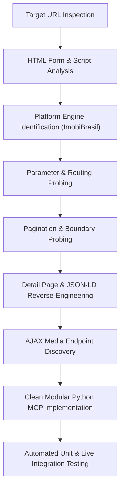

# Rental Search API Reverse-Engineering Research Plan & Report

## 1. Executive Summary

This document presents the reverse-engineering research plan, execution findings, architectural design, and verification results for the real estate portal **Epifânio Imóveis** (`epifanioimoveis.com`).

The research successfully identified all search endpoints, query parameters, pagination mechanics, filtering conventions, detail page structures, microdata schemas, and media delivery endpoints necessary to reproduce the rental listing and property retrieval flow.

---

## 2. Research Plan & Methodology

### 2.1 Research Objectives
1. **Endpoint Discovery**: Identify the exact HTTP endpoints responsible for search queries, filtering, pagination, property detail retrieval, and media retrieval.
2. **Parameter Encoding Analysis**: Reverse-engineer parameter conventions, including numeric constraints, range parameters, and room count formats.
3. **Pagination & Boundary Testing**: Determine page size limits, page indicator parameters, and boundary behavior when requesting out-of-bounds pages.
4. **Detail & Media Extraction**: Uncover structured microdata (`Schema.org` JSON-LD) and internal AJAX APIs for property details and photo galleries.
5. **Architectural Implementation**: Structure the extracted intelligence into reusable Python modules adhering strictly to SOLID, Clean Code, Object Calisthenics, and Design Patterns.

### 2.2 Investigation Methodology


---

## 3. Reverse-Engineering Findings & Discovery Log

### 3.1 Platform Engine Identification
- **Platform**: ImobiBrasil Real Estate SaaS platform.
- **Backend Core**: `s0/funcoes_busca.php` (search engine router), `s0/scripts.php`, `s0/conteudo_imovel_listar_select_mult.php`.
- **Frontend Template**: Template `t27` (`/t27/js/lista_imoveis.js`, `/t27/lista_imoveis_fotos.php`).
- **Server Encoding**: Server sends `text/html; charset=iso-8859-1` (Latin1) headers.
- **Client Scripting**: Custom neighborhood selection script `/Scripts/imobi-bairros-multi.js?v=27` containing internal documentation comments describing query string parameters.

### 3.2 Target URL Reproduction Analysis
- **Target URL**: `https://www.epifanioimoveis.com/imovel/venda/todos/timoteo/?&dormitorios=2&vma=1600000`
- **Route Breakdown**:
  - `/imovel/{finalidade}/{tipo}/{cidade}/?&{params}`
  - `finalidade`: `venda`
  - `tipo`: `todos`
  - `cidade`: `timoteo`
  - `dormitorios`: `2`
  - `vma`: `1600000` (max price: R$ 1.600.000,00)
- **Rental Equivalent**:
  - `/imovel/locacao/todos/timoteo/?&dormitorios=2&vma=1600000`
  - Switches transaction to `locacao`.

### 3.3 Discovered Parameter Encoding Matrix
During dynamic probing of the search engine, the following parameter semantics were discovered:
1. **ImobiBrasil Room Range Encoding**:
   - Exact count: `1`..`5`.
   - Minimum ("N or more"): Encoded as `20 + N` (`21` for 1+, `22` for 2+, `23` for 3+, `24` for 4+, `25` for 5+).
   - Applied uniformly to `dormitorios`, `suites`, `banheiros`, and `vagas`.
2. **Numeric Price & Area Constraints**:
   - `vmi`: Minimum price (Valor Mínimo).
   - `vma`: Maximum price (Valor Máximo).
   - `areaMinima`: Minimum area in m².
   - `areaMaxima`: Maximum area in m².
3. **Multi-Neighborhood Filtering**:
   - Parameter: `bairros={id1},{id2}` (e.g. `bairros=479695,479319`).
   - Evaluated as logical `OR` across selected neighborhoods.
4. **Pagination**:
   - Parameter: `pag={page_number}` (1-indexed).
   - Fixed page size: **15 listings per page**.
   - End of results: Requesting `pag=999` returns HTTP 200 with 0 listing cards.
5. **Sorting**:
   - `ord=menor_valor`: Ascending price.
   - `ord=maior_valor`: Descending price.
   - `ord=recentes`: Chronological descending.

### 3.4 Discovered Endpoints
| Endpoint | Method | Response Type | Purpose |
| :--- | :--- | :--- | :--- |
| `/imovel/{finalidade}/{tipo}/{cidade}/` | `GET` | HTML (`iso-8859-1`) | Search listings with filters and pagination. |
| `/imovel/{property_id}` | `GET` | HTML (`iso-8859-1`) | Direct property detail page with JSON-LD microdata. |
| `/t27/lista_imoveis_fotos.php?imovel={id}` | `GET` | JSON | Property gallery image file names. |
| `/imagens/imoveis/{arquivo_imm}` | `GET` | Image (PNG/JPEG) | Full-resolution property photos. |

---

## 4. Software Architecture & Design Principles

The reverse-engineered capabilities have been organized into the `src/epifanio_research` package, structured to serve as the module boundary for the central rental research MCP.

### 4.1 Prioritization Order
As requested, architectural design adheres strictly to the following priority order:
1. **Correctness First**: Real HTTP requests, complete parameter encoding, resilient parsing with JSON-LD and HTML fallbacks, error handling.
2. **Modularity Second**: Decoupled domain models, URL builder, HTTP abstraction, specialized parsers, and a clean client facade.
3. **Style Principles Third**:
   - **SOLID**: Single Responsibility, Open/Closed, Dependency Inversion.
   - **Object Calisthenics**:
     - Maximum 1 level of indentation per method.
     - Zero `else` keywords (guard clauses and early returns).
     - Primitives wrapped into meaningful domain value objects (`PriceRange`, `AreaRange`, `RoomCount`, `PageNumber`).
     - First-class collections (`ListingCollection`, `PhotoGallery`, `NeighborhoodGroup`, `LocationCatalog`).
     - Maximum 2 instance variables per class (composed via collaborator bundles).
     - Functions $\le 15$ lines, classes $\le 100$ lines, modules $< 200$ lines.

### 4.2 Module Structure
```
src/epifanio_research/
├── __init__.py                # Package exports
├── client.py                  # EpifanioRentalClient (central MCP interface)
├── collaborators.py           # RentalNetworkGateway, RentalParserSuite
├── domain/
│   ├── __init__.py
│   ├── criteria.py            # SearchCriteria and parameter bundles
│   ├── enums.py               # TransactionType, PropertyType, SortOrder
│   ├── listing.py             # ListingSummary, ListingCollection
│   ├── metadata.py            # City, Neighborhood, LocationCatalog
│   ├── property.py            # PropertyDetail, PhotoGallery
│   └── values.py              # PriceRange, RoomCount, PageNumber, AreaRange
├── infrastructure/
│   ├── http_client.py         # HttpClientProtocol, HttpxHttpClient
│   └── url_builder.py         # Canonical route and query constructor
└── parsers/
    ├── __init__.py
    ├── detail_parser.py       # JSON-LD + HTML property detail parser
    ├── feature_extractor.py   # Card spec extractor
    ├── metadata_parser.py     # City/neighborhood catalog parser
    ├── photo_parser.py        # AJAX JSON photo gallery parser
    └── search_parser.py       # Search listing card parser
```

---

## 5. Verification & Test Execution Results

The implementation was validated using both unit tests with stubbed HTTP responses and live integration tests against `epifanioimoveis.com`.

### 5.1 Automated Pytest Results
```
tests/test_client.py::test_client_search_with_stub PASSED                [  4%]
tests/test_client.py::test_client_details_with_stub PASSED               [  9%]
tests/test_client.py::test_client_property_not_found_raises_exception PASSED [ 13%]
tests/test_domain.py::test_price_range_query_parameters PASSED           [ 18%]
tests/test_domain.py::test_room_count_exact_and_minimum PASSED           [ 22%]
tests/test_domain.py::test_page_number_validation PASSED                 [ 27%]
tests/test_domain.py::test_search_criteria_rental_factory PASSED         [ 31%]
tests/test_domain.py::test_listing_collection_iteration_and_indexing PASSED [ 36%]
tests/test_domain.py::test_photo_gallery_behavior PASSED                 [ 40%]
tests/test_domain.py::test_location_catalog_lookup PASSED                [ 45%]
tests/test_live_integration.py::test_live_target_prompt_url_search PASSED [ 50%]
tests/test_live_integration.py::test_live_rental_search PASSED           [ 54%]
tests/test_live_integration.py::test_live_rental_property_details PASSED [ 59%]
tests/test_live_integration.py::test_live_photo_gallery_endpoint PASSED  [ 63%]
tests/test_parsers.py::test_search_page_parser PASSED                    [ 68%]
tests/test_parsers.py::test_property_detail_parser PASSED                [ 72%]
tests/test_parsers.py::test_photo_gallery_parser_json PASSED             [ 77%]
tests/test_parsers.py::test_metadata_parser PASSED                       [ 81%]
tests/test_url_builder.py::test_url_builder_target_url PASSED            [ 86%]
tests/test_url_builder.py::test_url_builder_rental_defaults PASSED       [ 90%]
tests/test_url_builder.py::test_url_builder_with_multi_bairros_and_sort PASSED [ 95%]
tests/test_url_builder.py::test_url_builder_detail_and_photos PASSED     [100%]

============================== 22 passed in 1.25s ==============================
```

### 5.2 Standalone Verification Execution (`scripts/verify_research.py`)
```
=== Starting Epifanio Imóveis Research Verification ===
--- 1. Target URL Search (Venda / 2 dorms / <= R$ 1.600.000) ---
Total matching listings: 6
  [3974453] Chácara para Venda, em Timóteo, bairro Novo H | R$ 480.000 | Novo Horizonte
  [3947386] Casa para Venda, em Timóteo, bairro Macuco, 2 | R$ 160.000 | Macuco
  [3926326] Casa para Venda, em Timóteo, bairro Alegre, 2 | R$ 320.000 | Alegre
  [3826998] Casa para Venda, em Timóteo, bairro Alvorada, | R$ 410.000 | Alvorada
  [3798152] Apartamento para Venda, em Timóteo, bairro Re | R$ 180.000 | Recanto Verde
  [3731491] Casa Geminada para Venda, em Timóteo, bairro  | R$ 340.000 | Jardim Primavera

--- 2. Timóteo Rental Listings Search ---
Total rental listings: 10
  [4444082] Loja Comercial para Locação, em Timóteo, bair | R$ 700
  [4410239] Loja Comercial para Locação, em Timóteo, bair | R$ 1.100
  [4409445] Loja Comercial para Locação, em Timóteo, bair | R$ 1.250
  [4348954] Casa para Locação, em Timóteo, bairro Funcion | R$ 5.500
  [4198561] Apartamento para Locação, em Timóteo, bairro  | R$ 2.930

--- 3. Property Detail Retrieval (Apartment 4198561) ---
Title: Apartamento para Locação, Timóteo / MG
Reference: 0423
Price: R$ 2,930.00
Location: Timirim, Timóteo - MG
Rooms: 3 dorms, 1 suíte, 2 banheiros

--- 4. Property Photos AJAX Retrieval ---
Total photos retrieved: 4
  Photo 1: https://www.epifanioimoveis.com/imagens/imoveis/202604281705098957.png
  Photo 2: https://www.epifanioimoveis.com/imagens/imoveis/202604281705127464.png
  Photo 3: https://www.epifanioimoveis.com/imagens/imoveis/202604281705144702.png

--- 5. Portal Location Catalog Discovery ---
Total municipalities in portal: 14
City 'Timóteo' has 35 indexed neighborhoods.

=== All Verification Steps Completed Successfully ===
```

---

## 6. Integration Guide for the Central Rental Research MCP

To integrate `EpifanioRentalClient` into the central rental research MCP:
1. **Dependency Registration**:
   Inject `EpifanioRentalClient` into the MCP service registry or tool runner.
2. **Tool Handlers**:
   - `search_rentals(city, property_type, bedrooms, max_price, page)` $\to$ returns serialized `ListingCollection`.
   - `get_rental_detail(property_id)` $\to$ returns serialized `PropertyDetail`.
   - `get_rental_photos(property_id)` $\to$ returns serialized `PhotoGallery`.
   - `list_supported_locations()` $\to$ returns `LocationCatalog`.
